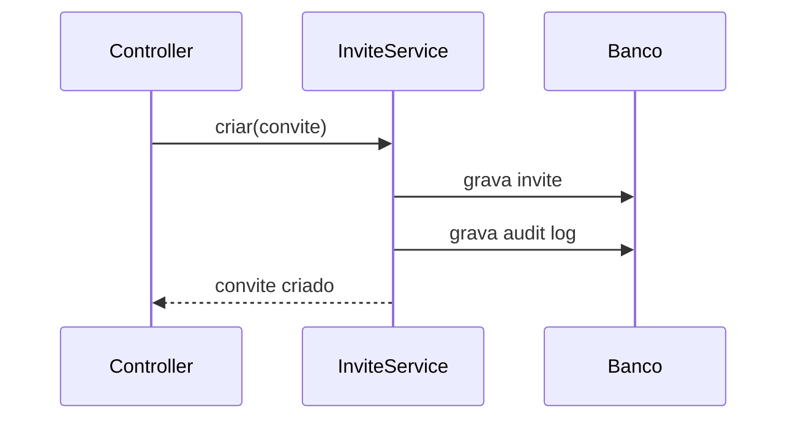

Esta skill roda no **repositório de destino**. Ela recebe o número de uma
issue já existente **neste repositório** (ex.: `31`) e a elabora,
completando-a com a spec de implementação. Vale para os dois tipos que entram
na esteira: `Task` e `Bug`.

Esta skill **não cria uma issue nova**. A issue já existe e já é a fonte de
verdade dessa fatia de trabalho — criada pelo `/refine`, a partir de uma
Story, ou direto neste repositório por `/task`, `/bug` ou `/tech-debt`. Sua
função é editá-la (`gh issue edit`), preenchendo as seções que faltam — não
duplicar o trabalho em outro lugar.

A spec é gerada **agora**, contra o código como ele está hoje — não contra o
código que existia no momento do refinamento. Leia o código de verdade.

**Esta skill não pergunta nada ao usuário.** Ela tem exatamente dois
desfechos: ou a Task já tem tudo que a Fase 2 exige e a spec é publicada
direto, ou falta alguma coisa e a Task é escalada — sem decisão silenciosa e
sem sessão travada esperando resposta. Ver "Procedimento de escalonamento"
no fim.

## Fase 1 — Contexto (silencioso)

1. Leia a Task issue `<número>` neste repositório:

   ```bash
   gh issue view <número> --json title,body,parent,blockedBy
   ```

2. **Leia a issue de planejamento (o pai), se houver** — o número e
   repositório vêm do campo `parent`:

   ```bash
   gh issue view <número-do-pai> --repo <ORG>/<planning-repo> --comments
   ```

   Inclua os comentários **"Contexto do planejamento"** e **"Contexto do
   refinamento"** dessa issue — sem `--comments`, `gh issue view` não os
   mostra. É ali que decisões de produto e perguntas da seção "Perguntas em
   aberto" podem já ter sido resolvidas pelo `/refine`, mesmo que o corpo da
   issue (que nunca é editado depois de criado) ainda liste a pergunta como
   pendente. Não pergunte de novo o que já está lá — nem no corpo, nem nos
   comentários.

   **`parent` vazio é normal**, não é erro: a issue foi criada direto neste
   repositório por `/task`, `/bug` ou `/tech-debt`, sem passar por Story. Nesse
   caso pule este passo — o contexto equivalente está na seção `## Entrada
   original` do corpo (o pedido como foi feito) e no comentário
   **"Contexto do /task"**, **"Contexto do /bug"** ou **"Contexto do
   /tech-debt"** da própria issue, que registra as perguntas já respondidas e
   as suposições declaradas. Leia os dois com `gh issue view <número>
   --comments`.
3. Verifique se as Tasks em `blockedBy` já foram concluídas. Se não foram,
   **não pergunte** — anote como um ponto pendente para a Fase 2 e continue
   lendo o resto do contexto.
4. Explore o código atual: arquivos afetados, padrões existentes, testes que
   cobrem a área, abstrações que já existem e podem ser reaproveitadas.
5. Leia o `CLAUDE.md` deste repositório. Se a Task é de frontend, preste
   atenção às diretrizes de layout — a "Abordagem escolhida" (Fase 4) deve
   segui-las, não propor um padrão novo.
6. Se o corpo da Task tiver a seção `## Referências de design` (criada pelo
   `/refine`), leia a(s) imagem(ns) referenciada(s) — estão versionadas em
   `docs/design-refs/<número-da-task>/` neste repositório — e use-as para
   embasar a "Abordagem escolhida" na Fase 4.

## Fase 2 — Verificação de insumos

Confira, sem perguntar nada, se a Task já tem tudo que a spec precisa:

| # | Item | Falha se |
|---|---|---|
| 1 | Direção técnica registrada | Seção "Direção técnica" vazia ou ausente |
| 2 | Direção técnica ainda viável | O código mudou desde a criação da issue e a abordagem descrita não se aplica mais |
| 3 | Critérios de aceite objetivos | Algum critério herdado é subjetivo ("melhorar", "ficar mais rápido") |
| 4 | Arquivos citados como existentes existem | Algum caminho citado no Escopo como já existente, ou descoberto na Fase 1 como tal, não existe no repositório hoje — arquivos citados como "a criar" não entram aqui, é esperado que ainda não existam |
| 5 | Dependências resolvidas | Alguma Task em `blockedBy` ainda está aberta |
| 6 | Sem pergunta em aberto bloqueante | Há algo não resolvido que afeta esta issue, na seção "Perguntas em aberto" — da issue de planejamento, quando existe pai, ou do corpo da própria issue, quando ela nasceu direto no repositório |
| 7 | Fora de escopo preenchido | A seção está vazia ou ausente |

Se **todos** passarem, siga para a Fase 3. Se **qualquer um** falhar, pare
aqui e vá direto para "Procedimento de escalonamento" — não pergunte, não
decida sozinho, não gere spec parcial.

**Item 5 é um caso à parte.** Dependência pendente não é ambiguidade, é
tempo — não há suposição para adotar nem decisão para pedir. Se o item 5 for
a **única** falha, isso não é escalonamento (ver "Procedimento de
escalonamento" abaixo para o que fazer nesse caso).

## Fase 3 — Abordagem

A direção técnica da Task, já validada na Fase 2, é vinculante. Confirme em
uma linha qual direção está seguindo e siga para a redação.

## Fase 4 — Elaboração

Complete o corpo da Task issue no formato abaixo.

```markdown
## Contexto
[herdado de quem criou a issue — não reescreva]

## Escopo
[herdado de quem criou a issue — não reescreva a menos que o código tenha mudado]

## Contexto de implementação
Arquivos afetados: caminho/arquivo.ts:40-90, caminho/outro.ts
Padrões a seguir: [abstrações existentes a reaproveitar]
Restrições: [ex: não quebrar a API pública, manter compatibilidade com X]

## Abordagem escolhida
[O que vamos fazer e por que não as alternativas. 3-6 linhas.]

## Fora de escopo
[herdado de quem criou a issue, complementado se algo novo ficou de fora]

## Critérios de aceite
- [ ] [verificável sem julgamento subjetivo]
- [ ] [prefira critérios executáveis: "os testes em tests/x/ passam"]

## Direção técnica
[herdado de quem criou a issue]

## Classe
[herdado de quem criou a issue]

## Decisões
[Escolhas com alternativa descartada. Candidatas a ADR.]
```

Ordem das seções herdadas preservada como veio — esta skill completa a issue,
não a reestrutura. Isso vale também para as seções que só existem em certos
tipos: `## Sintoma`, `## Reprodução`, `## Comportamento esperado`,
`## Evidência` e `## Causa raiz` numa issue de `/bug`; `## Problema`,
`## Evidência`, `## Impacto` e `## Resultado esperado` numa de `/tech-debt`;
`## Entrada original` em todas as criadas direto no repositório. Não remova
nem reescreva nenhuma delas — acrescente as suas. Sem seção "Depende de": a
dependência é a relação nativa `blockedBy`, já checada no item 5 da Fase 2;
duplicar em texto só criaria uma segunda versão que pode divergir da real.

### Diagrama (condicional)

**Nunca para Classe `mecânica`** (bump, rename, mover arquivo — não há
arquitetura para desenhar) **nem para mudança que toca um arquivo só.**
Fora isso, se a abordagem envolve múltiplos componentes que **interagem
entre si** (não arquivos paralelos e independentes — isso é lista, não
diagrama), inclua um diagrama Mermaid pequeno (arquitetura ou sequência, o
que couber melhor) dentro de "Contexto de implementação" ou "Abordagem
escolhida":



Não é obrigatório na maioria das Tasks — a regra existe para o caso em que
prosa deixaria a interação menos clara que um desenho de 5 linhas, não para
virar hábito. `/execute` não gera um novo: se este existir, o PR aponta
para a Task issue (`Closes #N`) e o diagrama já fica visível para quem
revisa.

### Regras de qualidade — verifique antes de publicar

- Nenhum critério de aceite pode ser subjetivo. "Melhorar a legibilidade" não é
  critério. "A função `validate()` tem no máximo um nível de aninhamento" é.
- A seção "Fora de escopo" nunca fica vazia. Se você não souber o que colocar,
  liste as melhorias adjacentes que você teve vontade de fazer e não vai fazer.
- A spec cabe em uma tela. Se não couber, a Task está grande demais — isso é
  motivo de escalonamento (ver abaixo), não de uma spec gigante.
- O plano de implementação (ordem dos passos, quais funções criar) **não**
  entra na spec. Isso é decidido no `/execute`.

## Fase 5 — Publicação

Assim que a Fase 4 terminar, publique — sem aguardar aprovação:

1. Atualize a Task issue com o corpo completo:

   ```bash
   gh issue edit <número> --body-file <arquivo temporário com o corpo atualizado> \
     --add-label spec-ready --remove-label needs-human
   ```

   `--remove-label needs-human` é seguro mesmo quando a Task nunca teve o
   label — cobre o caso de uma Task que escalou antes e está sendo
   reprocessada agora que os pontos foram resolvidos.

2. Mova o card da Task no Project de `Refined` para `Ready` via `gh project
   item-edit`: resolva `PROJECT_ID`, o `field-id` de `Status` e o `option-id`
   de `Ready`, e o `id` do item pela URL desta Task issue.

3. Comente na Task issue, título **"Contexto do /spec"**, com a data, uma
   linha confirmando que os insumos já estavam completos, sem necessidade de
   escalonamento, e qual skill criou a issue (`/refine`, `/task`, `/bug` ou
   `/tech-debt` — veja o comentário de contexto dela):

   ```bash
   gh issue comment <número> --body-file <comentário>
   ```

   Este comentário acontece **sempre**, mesmo sem nada de especial a
   reportar — é o que permite, junto com o comentário do procedimento de
   escalonamento abaixo, medir ao longo do tempo quantas issues cada porta de
   entrada já deixa prontas para o `/spec` publicar direto.

4. Informe o número da Task e o comando para começar: `/execute <número>`.
   Confirme que o card já está em `Ready` no GitHub Project.

## Procedimento de escalonamento (quando a Fase 2 falha)

Nenhuma decisão silenciosa. Nenhuma spec parcial. Nenhuma pergunta que trava
a sessão esperando resposta. O procedimento muda conforme o que falhou:

### Só o item 5 (dependência) falhou

Não é escalonamento — é espera. **Não** aplique `needs-human`, **não**
comente. O bloqueio já é visível nativamente (`is:blocked`, view
"Bloqueadas"); comentar de novo só duplicaria informação que o GitHub já
mostra. Encerre a sessão informando qual Task em `blockedBy` ainda está
aberta e sugerindo rodar `/spec <número>` de novo quando ela fechar. Não
mova o card — fica em `Refined`.

### O item 5 falhou junto com outro(s), ou outro item falhou (com ou sem o 5)

1. Marque a Task com o label `needs-human`:

   ```bash
   gh issue edit <número> --add-label needs-human
   ```

2. Comente na Task issue, título **"Escalonamento do /spec"**, separado em
   até duas seções conforme o que falhou:

   - **"Aguardando dependência"** (só se o item 5 também falhou) — qual Task
     em `blockedBy` ainda está aberta. Sem suposição — não há o que decidir,
     só esperar.
   - **"Dúvida — decisão necessária"** (para os itens 1, 2, 3, 4, 6 e 7 que
     falharem) — para cada um: o que está faltando ou é ambíguo, por que
     isso impede a spec de seguir sem alucinar ou assumir algo em silêncio,
     e a suposição que o `/spec` adotaria se fosse forçado a decidir
     sozinho — para o humano poder só confirmar em vez de escrever a
     resposta do zero.

   ```bash
   gh issue comment <número> --body-file <comentário>
   ```

3. **Não** edite o corpo da Task issue. **Não** mova o card — fica em
   `Refined`. Encerre a sessão informando que a Task foi marcada
   `needs-human` e por quê.

Depois que os pontos forem resolvidos (editando a Task issue e/ou
respondendo ao comentário, ou a dependência fechando), a Task volta para a
esteira só por rodar `/spec <número>` de novo — não é preciso remover o
label manualmente, a Fase 5 já faz isso quando a Task passa limpa.
