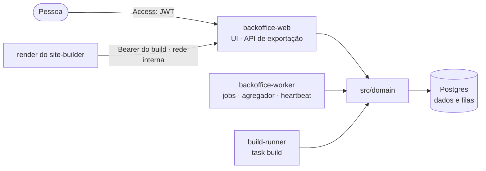

# Visão geral do Backoffice

Consulte antes de mudar um fluxo, uma rota da API ou os processos. Sistema e contratos entre
unidades: `docs/architecture/overview.md` da raiz.

## Papel

Ferramenta administrativa (não é CMS): fonte única do conteúdo e da configuração dos sites,
revisão humana, publicação, registro de sites e releases. Dona do Postgres e da API de
exportação. Os sites nunca chamam o Backoffice.

## Processos (uma imagem)

| Processo             | Comando                                           | Faz                                                          |
| -------------------- | ------------------------------------------------- | ------------------------------------------------------------ |
| `backoffice-web`     | `node .next/standalone/apps/backoffice/server.js` | UI e route handlers (API de exportação, saúde)               |
| `backoffice-worker`  | `node src/bin/worker.ts`                          | Jobs gerais e agregador pelo cron do Graphile Worker         |
| `build-runner`       | `node src/bin/build-runner.ts`                    | Só a task `build`, concorrência 2 (entra com o `build-site`) |
| `backoffice-migrate` | `node src/bin/migrate.ts`                         | Migrações do Drizzle e do Graphile Worker; sai ao terminar   |

## Fluxo gerado: Sites → exportação

1. `db:seed` importa as fixtures do `content-model` pelo domínio (`importSnapshot`), com
   `recordPendingChange` em cada gravação.
2. `GET /api/export/v1/sites/{site}/snapshot` (só rede interna, token do build) abre uma
   transação `REPEATABLE READ` só de leitura e devolve NDJSON: `header` com as mudanças
   pendentes visíveis, entidades, `end` com as contagens.
3. A tela `/sites` lista o registro de instâncias para quem tem `site.read`.

## Regras

- Regra de negócio só em `src/domain`; rotas, telas e jobs delegam.
- Toda gravação exportada registra a mudança pendente na mesma transação.
- Validação pelo `content-model`, contra os recursos da release do site.
- Identidade pelo Access em cada requisição; papéis no domínio.

## Backlog e pendências

`docs/decisions/0002-escopo-e-backlog.md` e `open_questions` em `docs/project-spec.yaml`.
