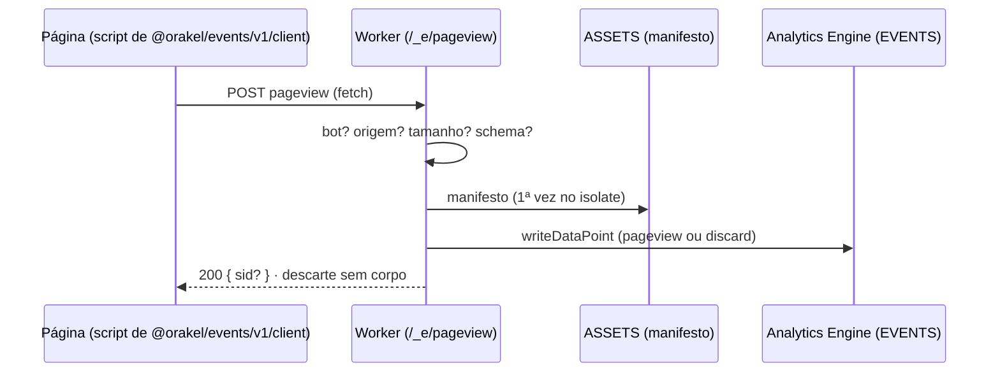

# Visão geral do Worker de borda

Consulte antes de mudar a rota de eventos, as regras de validação ou o `wrangler.jsonc`.
Visão do sistema: `docs/architecture/overview.md` da raiz; formato dos eventos:
`packages/events/docs/architecture/overview.md`.

## Papel

Cada site é um Worker com Static Assets. Este é o único código que executa na borda, e
só em `/_e/*`: o resto do site é estático e nem aciona o Worker.

## Regras

- O navegador informa o mínimo: site vem de `SITE_ID`, país de `request.cf.country`,
  caminho do artigo do manifesto, horário do próprio Analytics Engine. Nunca o IP.
- Sessão só quando `canIssueSession(país)` permite; no EEE, Reino Unido e Suíça, nenhuma.
- Todo descarte vira um ponto `discard` com o motivo; o agregador alerta sobre excesso.
- Falha na medição perde o evento, nunca a página: exceção responde `204`.

## Configuração

| Binding / variável       | Origem                                       |
| ------------------------ | -------------------------------------------- |
| `SITE_ID`                | Var do Worker (cadastro do site)             |
| `EVENTS`                 | Dataset `events` do Analytics Engine         |
| `ASSETS`                 | Static Assets do site (manifesto de eventos) |
| `ALLOW_COUNTRY_OVERRIDE` | Só no desenvolvimento e no alvo local        |

## A definir

Ver `open_questions` em `docs/project-spec.yaml`: geração do `wrangler.jsonc` por site no
`build-site`, testes no workerd, sinal de consentimento na fase 3.
