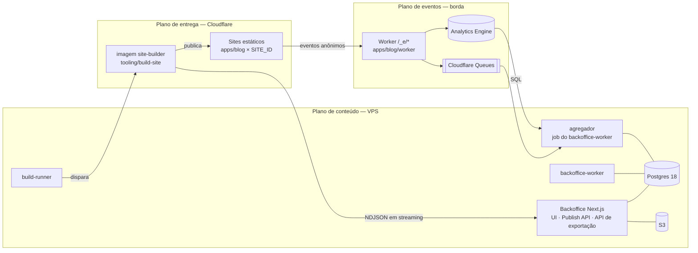

# Visão geral da arquitetura

Consulte antes de criar uma unidade, mudar um contrato entre unidades ou decidir onde
um código deve morar. Decisões e alternativas: `docs/decisions/0003` a `0005`.

## Propósito

Rede de 5 a 20 sites de conteúdo gerados a partir de **uma única base de código**
(single codebase, multi-instance). O conteúdo é gerado com LLM e revisado por uma pessoa
no Backoffice. Nada é específico de um site no código: tudo que varia entre sites
(domínio, idioma, fuso, tema, presets, variantes, flags, textos institucionais,
integrações) é **configuração** validada por `@orakel/content-model`.

## Planos

- **Conteúdo:** o Backoffice é um monolito modular. Uma única imagem atende três
  comandos: web, `backoffice-worker` (jobs gerais e agregador, ADR 0009) e `build-runner`. É dono do schema
  do Postgres e das migrações.
- **Entrega:** a imagem `site-builder` lê a API de exportação e gera o site estático de
  cada `SITE_ID`; o `wrangler.jsonc` de cada site é gerado pelo `build-site`. O SSR do
  `apps/blog` existe só para a visualização no Backoffice.
- **Eventos:** o Worker de borda grava eventos anônimos no Analytics Engine e na fila;
  o agregador consolida no Postgres.

## Contratos entre unidades

| Contrato                                                        | Dono                    | Consumidores                                             |
| --------------------------------------------------------------- | ----------------------- | -------------------------------------------------------- |
| Conteúdo e configuração de site (Zod, `schemaVersion`)          | `@orakel/content-model` | backoffice, content-client, blog, build-site             |
| API de exportação (NDJSON em streaming, uma entidade por linha) | backoffice              | `@orakel/content-client` (loader Astro, leitura ao vivo) |
| Formato de eventos (payload, layout do AE, mensagem de fila)    | `@orakel/events`        | blog-worker, agregador                                   |
| Variáveis CSS dos temas                                         | `@orakel/tokens`        | elements, ui, blog                                       |

Regras de evolução: aditiva dentro de uma versão; mudança incompatível cria a próxima
versão; o parse ignora campos desconhecidos. Release do core por tag `core-vX.Y.Z`
(major = muda o schema da API ou exige migração de configuração).

## Mapa das unidades

Estado atual: a raiz, `packages/content-model`, `packages/content-client`, `packages/core`, `packages/elements`, `packages/tokens`, `packages/events`, `apps/blog`, `apps/blog/worker`, `apps/backoffice`, `tooling/build-site` e `infra/local/edge-local`. Cada unidade é gerada com `/scaffold` (modo `unit`) e
passa a constar do `CLAUDE.md` da raiz e de `units:` em `docs/project-spec.yaml`.

| Caminho                   | Pacote                   | Camada ESLint              | Papel                                                                  |
| ------------------------- | ------------------------ | -------------------------- | ---------------------------------------------------------------------- |
| `apps/blog`               | `@orakel/blog`           | app                        | App Astro dos sites, por `SITE_ID` (estático + SSR de visualização)    |
| `apps/blog/worker`        | `@orakel/blog-worker`    | app                        | Worker de borda `/_e/*`                                                |
| `apps/backoffice`         | `@orakel/backoffice`     | app                        | UI, Publish API, API de exportação; worker (e agregador), build-runner |
| `apps/generator`          | `@orakel/generator`      | app                        | Geração com LLM (fase 2)                                               |
| `packages/content-model`  | `@orakel/content-model`  | domain                     | Schemas Zod de conteúdo e configuração                                 |
| `packages/content-client` | `@orakel/content-client` | domain (`/astro`: adapter) | Cliente da API de exportação                                           |
| `packages/core`           | `@orakel/core`           | domain                     | SEO, sitemap, RSS, robots, `_redirects`, `_headers`                    |
| `packages/tokens`         | `@orakel/tokens`         | domain                     | Temas → variáveis CSS, contraste AA                                    |
| `packages/elements`       | `@orakel/elements`       | domain                     | Web Components                                                         |
| `packages/events`         | `@orakel/events`         | domain                     | Formato versionado dos eventos                                         |
| `packages/ui`             | `@orakel/ui`             | ui                         | Ilhas React (último recurso)                                           |
| `adapters/astro`          | `@orakel/astro`          | adapter                    | Integração Astro                                                       |
| `tooling/build-site`      | `@orakel/build-site`     | app                        | Render e publish; base de `docker/site-builder`                        |

## Raiz do repositório

| Pasta/arquivo                                                    | Conteúdo                                           |
| ---------------------------------------------------------------- | -------------------------------------------------- |
| `tooling/{tsconfig,eslint-config,prettier-config,vitest-config}` | Configurações compartilhadas                       |
| `infra/vps/compose.yaml`                                         | Compose base (produção)                            |
| `infra/local/`                                                   | Override local (portas, SeaweedFS) e `compose.sh`  |
| `docker/docker-bake.hcl`, `docker/bake.sh`                       | Alvos e tags das imagens                           |
| `.github/workflows/`                                             | `ci`, `images`, `release`, `e2e`, `add-to-project` |
| `turbo.json`, `pnpm-workspace.yaml`                              | Tarefas e catálogo de versões                      |

## Como criar uma unidade

1. Rode `/scaffold` apontando para `apps/<nome>`, `packages/<nome>` ou `adapters/<nome>`.
2. O `package.json` usa o escopo `@orakel/`, dependências internas `workspace:*` e
   externas `catalog:` (adicione a versão em `pnpm-workspace.yaml` antes).
3. `tsconfig.json` estende `@orakel/tsconfig/library.json` (pacotes) ou `node.json`
   (processos Node); Astro e Next estendem também o tsconfig do framework.
4. `eslint.config.js` usa `layer('<camada>', import.meta.dirname)` de `@orakel/eslint-config`.
5. Scripts com os nomes do pipeline: `dev`, `build`, `lint`, `typecheck`, `test` e, quando
   couber, `test:contract`, `build:examples`, `test:a11y`, `test:parity`, `test:e2e`,
   `db:migrate`, `db:seed`.
6. Imagem: `Dockerfile` com `turbo prune --docker` e alvo no `docker/docker-bake.hcl`.
7. Serviço de longa duração: entra em `infra/vps/compose.yaml`.

## Requisitos não funcionais

- **Orçamento de JS** por página nos sites de exemplo, verificado no CI.
- **Paridade estático × SSR**: a visualização renderiza o mesmo HTML que o build.
- **Acessibilidade** WCAG 2.2 AA (`docs/design/accessibility.md`).
- **Privacidade**: eventos anônimos — sem cookie, sem identificador persistente, sem IP
  armazenado (LGPD).
- **Dependências**: correções de segurança em até 7 dias; críticas de Next.js ou React em
  até 48 h (Renovate).
- **Custo**: planos gratuitos/baratos da Cloudflare e uma VPS pequena.

## A definir

Ver `open_questions` em `docs/project-spec.yaml` (provedor S3 de produção, segredos de
produção, modo local do Access, entre outros).
