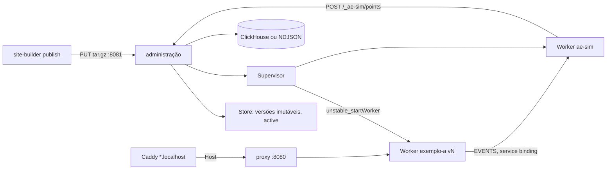

# Visão geral do edge-local

Consulte antes de mexer na publicação local, nas versões ou no runtime dos Workers.

- Runtime e proxy: ADR 0002. Versões e API: ADR 0003. Fidelidade: ADR 0004. Imagem e compose: ADR 0005. `ae-sim`: ADRs 0006 e 0007.
- Só local. Em produção, o mesmo `tar.gz` segue para `wrangler deploy` (alvo `cloudflare` do build-site).
