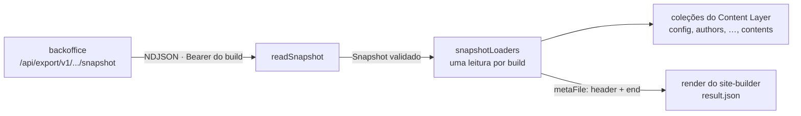

# Visão geral do content-client

Consulte antes de mudar a leitura do snapshot, os loaders ou a classificação de falhas.
Contrato do snapshot: `packages/content-model/docs/architecture/overview.md`.

- **Leitura:** streaming, cada linha pelo `parseSnapshotLine` (campo desconhecido é
  descartado), o conjunto pelo `validateSnapshot` (header, end e contagens detectam corte).
- **Falhas:** `Result` + `failureKind` (transitória × permanente).
- **Loaders:** um por coleção, mesma leitura, `metaFile` para o render; sem `schema` do Astro.
- **Visualização ao vivo:** ainda não (ADR 0002).

Quem configura: o `content.config.ts` do blog (URL da API, site, token do build e caminho
absoluto do `metaFile`, lidos do ambiente do render).
