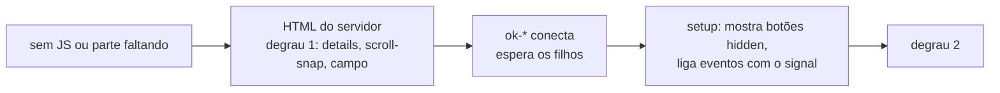

# Visão geral do elements

Consulte antes de criar ou mudar um Web Component.

- Só comportamento sobre o HTML do servidor, em light DOM (ADR 0002). Estilo e textos são do blog.
- Quatro elementos: `ok-carousel`, `ok-menu`, `ok-copy-link`, `ok-share` (ADR 0003).
- Cada elemento é registrado pelo seu subcaminho, importado pelo componente `.astro` que o usa (ADR 0004).
- Tudo conta no orçamento de JS do blog (artigo ≤ 15 kB).
