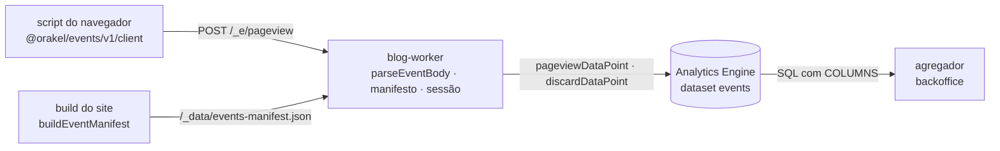

# Visão geral do events

Consulte antes de mudar o payload, o layout do Analytics Engine, o manifesto, as regras
de sessão ou o script do navegador. Visão do sistema: `docs/architecture/overview.md` da raiz.

## Papel

Contrato dos eventos do plano de eventos. Cada lado importa a mesma versão:

| Consumidor     | Usa                                                                                                                 |
| -------------- | ------------------------------------------------------------------------------------------------------------------- |
| blog (páginas) | `startPageviewTracking` de `/v1/client`                                                                             |
| blog (build)   | `buildEventManifest`, `EVENT_MANIFEST_PATH`                                                                         |
| `blog-worker`  | `parseEventBody`, `parseEventManifest`, `indexManifest`, `canIssueSession`, `pageviewDataPoint`, `discardDataPoint` |
| agregador      | `COLUMNS`, `EVENT_TYPES`, `DISCARD_REASONS`, `SUPPORTED_FORMAT_VERSIONS`                                            |

## Regras do contrato

- **O navegador informa o mínimo.** Site, horário, país e IP nunca vêm do payload: o
  Worker deriva. Campos extras são descartados pelo parse.
- **Privacidade:** nenhum campo de IP; referrer gravado só como host; sessão só com ID
  aleatório, nunca no EEE, Reino Unido e Suíça nem com país desconhecido.
- **Layout posicional:** um único lugar sabe as posições (`layout.ts`). Posição nova só
  no fim; nunca reordene nem reaproveite (ADR 0002).
- **Descartes contam:** ponto `discard` com o motivo em `blob9` (ADR 0005).
- **O script não carrega o Zod** e não passa de 2 kB com gzip (ADR 0004).

## A definir

Ver `open_questions` em `docs/project-spec.yaml`: calibrar layout, limite do corpo e
caminho do manifesto; fila e eventos de afiliado na fase 3; sinal de consentimento com o CMP.
