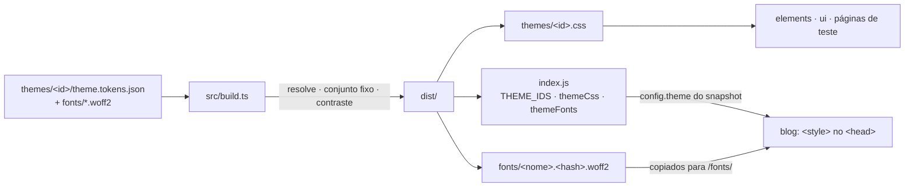

# Visão geral do tokens

Consulte antes de mudar um tema, o conjunto de tokens, o contraste ou a saída do build.

- **Entrada:** um tema por pasta, em DTCG (ADR 0002). Paleta primitiva em `palette`, usada por aliases; semânticos no conjunto fixo (ADR 0005).
- **Verificações:** tipos e valores, aliases (inexistente, ciclo, tipo diferente), conjunto fixo, contraste dos pares (ADR 0004), arquivos de fonte. Qualquer erro: código 1, todos os problemas listados, `dist/` intacto.
- **Saída:** CSS por tema e módulo com o CSS embutido (ADR 0003); fontes com hash (ADR 0006).
- **Quem usa:** o blog escolhe o tema pela configuração do site (dado, nunca `import.meta.env`); tema inexistente é falha permanente no build do site.
- **Modo escuro:** não por ora; cada tema declara `color-scheme` (ADR 0008).

O pacote é o único de domínio com build próprio: quem o consome depende de `^build` no Turbo, e `dist/` não é commitado.
